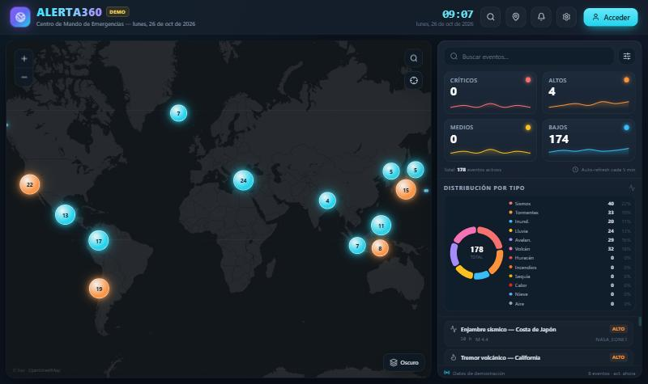
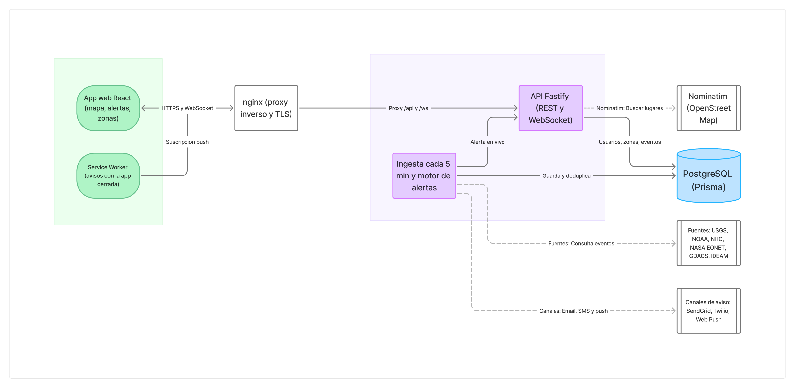
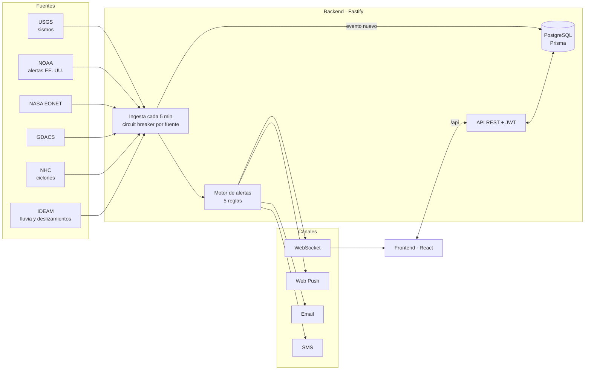

# 🌍 ALERTA360

**Alertas de desastres naturales según las zonas que te importan.** ALERTA360 reúne eventos de 6 fuentes oficiales (USGS, NOAA, NASA, GDACS, NHC e IDEAM) y avisa a cada persona cuando algo ocurre cerca de su casa, su trabajo o su familia.

[](https://github.com/armado719/ALERTA360/actions/workflows/ci.yml)
[](https://armado719.github.io/ALERTA360/)


### 👉 [Ver el demo en vivo](https://armado719.github.io/ALERTA360/)

<p align="center">
  
</p>

> El demo usa 178 eventos simulados y no necesita backend. La versión completa (con ingesta real, cuentas y alertas) se ejecuta en local; ver [Correrlo en local](#-correrlo-en-local).

---

## 🇬🇧 TL;DR (English)

ALERTA360 is a full-stack disaster-alert platform (React + Fastify + PostgreSQL, TypeScript end to end). It ingests 6 official sources every few minutes, de-duplicates events, matches them against each user's alert zones (circles or polygons, antimeridian-safe) and notifies them in real time via WebSocket, Web Push, email and SMS. It ships with 190 tests, CI, a production Docker/nginx/Prometheus setup and a [live demo](https://armado719.github.io/ALERTA360/). The section [Lo que aprendí](#-lo-que-aprendí-bugs-reales-con-datos-reales) describes real bugs found by testing against live data.

---

## 💡 Por qué existe

Después de varios terremotos y emergencias recientes, quedó claro un problema simple: la información existe, pero está repartida. Para saber si algo pasa cerca de ti hay que revisar el sitio del servicio geológico, el de meteorología, el de huracanes… y nadie hace eso a las 3 de la mañana.

ALERTA360 junta esas fuentes en un solo lugar y, en vez de pedirte que mires un mapa, **te avisa a ti** cuando un evento cae dentro de las zonas que elegiste.

---

## ✨ Qué hace

| | |
|---|---|
| 🗺️ **Mapa 2D y globo 3D** | Leaflet y MapLibre: clusters, mapa de calor, línea de tiempo de 24 h, satélite y terreno |
| 🔎 **Centro de eventos** | Ventana con filtros por tipo, severidad, fuente y período, con conteos, búsqueda y orden |
| 📍 **Zonas de alerta** | Círculos (1–1000 km) o polígonos definidos por sus vértices, con búsqueda de lugares o GPS |
| 🔔 **Alertas en vivo** | WebSocket si la app está abierta; Web Push si está cerrada; email (SendGrid) y SMS (Twilio) |
| ⚙️ **Preferencias** | Qué tipos de evento, desde qué severidad y por qué canales |
| 🇨🇴 **Datos de Colombia** | Lluvia intensa de las 488 estaciones del IDEAM y amenaza por deslizamientos en más de 500 municipios |
| 📊 **Observabilidad** | Métricas Prometheus, dashboard Grafana, `/health` y página de estado |

---

## 🏗️ Cómo funciona

<p align="center">
  
</p>

Un solo proceso Node.js hace dos trabajos: la **API Fastify** atiende a la app (REST y WebSocket) y la **ingesta** consulta las fuentes cada 5 minutos y pasa cada evento nuevo por el **motor de alertas**. Así fluyen los datos por dentro:



**El recorrido de un sismo:**
1. **Ingesta.** Cada 5 minutos se descarga cada fuente. Si una falla 3 veces seguidas, el *circuit breaker* la aísla 5 minutos para no frenar a las demás. Cada evento se identifica por un `externalId` estable, así nunca se guarda dos veces.
2. **Motor de alertas.** Con cada evento nuevo, busca usuarios que cumplan 5 reglas: evento activo con coordenadas reales, tipo que le interesa, severidad mínima, dentro de alguna de sus zonas y algún canal activo (el SMS solo desde severidad alta).
3. **Avisos.** Si el usuario tiene la app abierta, la alerta llega al instante por WebSocket. Si no, por Web Push. Email y SMS salen en segundo plano para no bloquear la ingesta.

---

## 🛰️ Fuentes de datos

| Fuente | Qué aporta | Cobertura |
|---|---|---|
| **USGS** | Sismos con magnitud y profundidad | Mundial |
| **NOAA / NWS** | Alertas oficiales: inundaciones, tormentas | EE. UU. |
| **NASA EONET** | Incendios, volcanes y tormentas vistos por satélite | Mundial |
| **GDACS** (ONU + UE) | Desastres con impacto humanitario (verde/naranja/rojo) | Mundial |
| **NHC** | Ciclones tropicales con su cono de pronóstico | Atlántico y Pacífico |
| **IDEAM** | Lluvia diaria por estación (≥ 50 mm) | Colombia |
| **IDEAM · OSPA** | Amenaza por deslizamientos por municipio (moderada y alta) | Colombia |
| **Meteoalarm** | Alertas meteorológicas | Europa (desactivada) |

> ⚠️ **Honestidad sobre "tiempo real":** las fuentes se consultan cada pocos minutos; no es una alerta sísmica temprana, que se mide en segundos. Sirve para enterarse rápido de lo que ya ocurrió y, en fenómenos que avisan con horas o días (huracanes, lluvias, inundaciones), para anticiparse. El IDEAM publica la lluvia una vez al día, así que esas alertas dicen "ayer", y el boletín de deslizamientos también es diario. Sus niveles orientan la preparación; no son una declaratoria oficial de alerta.

---

## 🧠 Decisiones técnicas

- **TypeScript de punta a punta**, con validación de entradas y de variables de entorno con **Zod** (la app no arranca si falta una variable crítica).
- **Fastify + Prisma** en el backend, con `buildApp()` separado del arranque: los tests levantan la app completa con una base de datos falsa en memoria, sin PostgreSQL.
- **Un *circuit breaker* por fuente**: una API caída o lenta (GDACS a veces tarda más de 45 s) no detiene la ingesta de las demás, y su estado se expone en `/api/sources/health`.
- **Deduplicación en dos niveles**: `externalId` por evento y un índice único `(usuario, evento, canal)` para que nadie reciba la misma alerta dos veces.
- **Zonas con polígono**: punto-en-polígono por *ray casting*, con el caso especial de los polígonos que cruzan el antimeridiano (±180°, por ejemplo en Fiji).
- **Filtros con conteos**: el Centro de eventos calcula los conteos sobre todos los eventos, no sobre los ya filtrados, para que una opción desmarcada no desaparezca.
- **Permisos bien pedidos**: las notificaciones del navegador se piden solo cuando el usuario pulsa "Activar", nunca al cargar la página.

---

## 🐞 Lo que aprendí: bugs reales con datos reales

La lección más importante del proyecto: **un test que pasa con datos inventados puede estar escondiendo un bug.** Estos se encontraron al probar contra las APIs reales.

| Bug | Causa | Arreglo |
|---|---|---|
| **El NHC duplicaba cada ciclón cada 5 minutos** | El código leía campos que la API no tiene (`STORMID`); sin ID estable, usaba la hora actual | Campos reales (`idp_source`, `stormtype`) y un evento por tormenta que se actualiza en cada aviso |
| **NOAA no guardaba ninguna alerta** | Leía la fecha de `starts`: 0 de 368 alertas reales traen ese campo | Fecha de `onset`, `effective` o `sent`; tests con alertas reales |
| **GDACS respondía 404** | Su API cambió de dirección y de formato | API nueva, paginación y fechas en UTC |
| **Los emails y SMS nunca salían con la app abierta** | Al enviar por WebSocket se marcaban como enviadas *todas* las notificaciones, incluidas las de email/SMS | Solo se marca el canal push, y solo de quien lo recibió; test de regresión |
| **Las notificaciones push nunca se configuraban** | `web-push` es CommonJS: en un backend ESM, `import * as` no exponía sus funciones | Import por defecto; el mock del test ahora imita el paquete real |
| **La búsqueda de lugares se quedaba colgada** | Un *preHandler* de Fastify síncrono que nunca llamaba a `done()` | `async`, con un test que falla sin el arreglo |
| **El CI del backend fallaba siempre** | Vitest heredaba el `postcss.config.js` del frontend, que necesita Tailwind | Configuración de PostCSS en línea para los tests |
| **La lluvia del IDEAM salía el doble en algunas estaciones** | Dos sensores (normal y GPRS) miden la misma lluvia | Sumar por sensor y quedarse con el mayor |
| **Mariquita (Tolima) caía fuera del mapa** | En la lista oficial de municipios (DIVIPOLA) sus coordenadas perdieron el punto decimal: latitud 525 | Corrección explícita y un test que exige que los 1.122 municipios caigan dentro de Colombia |

---

## ✅ Calidad

- **190 tests** (Vitest) en el backend: motor de alertas, geometría, cada fuente con respuestas reales, autenticación, rutas y circuit breaker.
- **CI en GitHub Actions**: type-check y build del frontend, tests y build del backend, y build de Docker en cada push y PR.
- **TypeScript estricto** en frontend y backend (`tsc --noEmit` sin errores).

```bash
cd backend
npm test
```

---

## 🚀 Correrlo en local

**Requisitos:** Node.js 20+ y Docker.

```bash
# 1. Base de datos (PostgreSQL en Docker)
docker compose up -d db

# 2. Backend (http://localhost:3000)
cd backend
cp .env.example .env
npm install
npx prisma db push
npm run dev

# 3. Frontend (http://localhost:5173), en otra terminal, desde la raíz
npm install
npm run dev
```

Las fuentes son gratuitas y no piden clave. Email, SMS y push son opcionales: sin sus claves, el sistema sigue funcionando y marca esos envíos como omitidos. Las variables están documentadas en [`backend/.env.example`](backend/.env.example). El IDEAM viene apagado: actívalo con `IDEAM_ENABLED=true` (lluvia) e `IDEAM_LANDSLIDE_ENABLED=true` (deslizamientos).

**Modo demo** (sin backend, el mismo que está publicado): `npm run build:demo && npx vite preview --base=/ALERTA360/`.

---

## 🧱 Stack

**Frontend:** React 18 · TypeScript · Vite · Tailwind CSS · Leaflet · MapLibre GL · Chart.js · Framer Motion
**Backend:** Node.js · Fastify 4 · Prisma 5 · PostgreSQL 16 · Zod · Pino · WebSocket · Web Push
**Infraestructura:** Docker Compose · nginx (TLS, CSP, rate limiting) · Prometheus · Grafana · GitHub Actions · GitHub Pages

---

## 📌 Estado y próximos pasos

- ✅ Ingesta de 8 fuentes, motor de alertas, zonas, Centro de eventos, autenticación y preferencias.
- ✅ Infraestructura de producción lista (Docker, nginx, métricas, backups, despliegue con rollback).
- ⏳ **Despliegue en un servidor propio**: pendiente de montar el servidor.
- ✅ **Amenaza por deslizamientos del IDEAM**: integrada tras un derecho de petición que el IDEAM respondió confirmando que sus alertas son de libre uso.
- ⏳ **Alertas hidrológicas del IDEAM** (crecientes de ríos) y **sismos del Servicio Geológico Colombiano**: la primera ya tiene fuente pública; la segunda espera respuesta.
- ⏳ App móvil (React Native) y modelos de ML: en esqueleto.

El historial completo de cambios está en la [bitácora](BITACORA.md).

---

## 🤖 Cómo se construyó

El proyecto se desarrolló con ayuda de asistentes de IA para programar (Claude Code, opencode y Cline). Yo definí qué construir, revisé y aprobé cada cambio antes de integrarlo, y cada función se probó contra datos reales; todo quedó documentado en la [bitácora](BITACORA.md).

---

## 👤 Autor

**Armando Ramírez Cardozo**
📧 [armado719@gmail.com](mailto:armado719@gmail.com) · 💼 [LinkedIn](https://www.linkedin.com/in/armando-ramirez-cardozo-94352b4a/) · 🐙 [github.com/armado719](https://github.com/armado719)

---

**Licencia:** [MIT](LICENSE) para el código.

**Créditos:** los iconos 3D de lluvia, tormenta, nieve y calor son de *Weather 3D Icons* de **Jahanvi** ([@me_Jahanvi](https://x.com/me_Jahanvi)), publicados en la Comunidad de Figma. Los demás iconos de tipos de desastre son propios.
